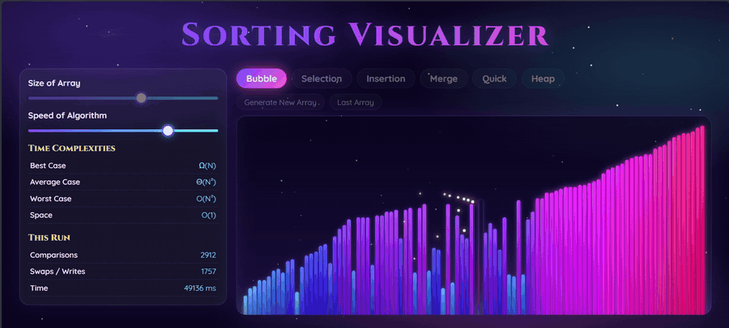

<div align="center">

# ✨ Sorting Visualizer

**Watch sorting algorithms come alive as glowing bars under a night sky.**




**[▶ Live demo](https://ayu-koda.github.io/sorting-visualizer/)**

</div>

---

## About

Sorting Visualizer is a small, dependency-free web app that shows how classic sorting algorithms work, one comparison and one swap at a time. Pick an algorithm, press its button, and watch the array sort itself while the side panel reports the algorithm's complexity and live statistics.

## Features

- **6 algorithms:** Bubble, Selection, Insertion, Merge, Quick and Heap Sort.
- **Colour tells the story**
  - 🤍 white glow: two bars being compared
  - 🟡 gold glow and sparkles: a swap or write
  - 🌸 rose glow: the pivot (Quick Sort) or current minimum (Selection Sort)
  - 🌈 soft glow: a bar that has reached its final place
  - a ripple of light sweeps across the bars when the sort finishes
- **Live controls:** change the array size (20–150) and the speed, even in the middle of a sort.
- **Generate New Array / Last Array:** run a different algorithm on the same data and compare.
- **Complexity panel:** best, average and worst case time, plus space complexity, for the selected algorithm.
- **Run statistics:** comparisons, swaps/writes and elapsed time.
- **Responsive** layout, and it respects `prefers-reduced-motion`.

## Algorithms

| Algorithm | Best | Average | Worst | Space |
|-----------|------|---------|-------|-------|
| Bubble    | Ω(N) | Θ(N²) | O(N²) | O(1) |
| Selection | Ω(N²) | Θ(N²) | O(N²) | O(1) |
| Insertion | Ω(N) | Θ(N²) | O(N²) | O(1) |
| Merge     | Ω(N log N) | Θ(N log N) | O(N log N) | O(N) |
| Quick     | Ω(N log N) | Θ(N log N) | O(N²) | O(log N) |
| Heap      | Ω(N log N) | Θ(N log N) | O(N log N) | O(1) |

## Run it locally

No build step and no installs.

```bash
git clone https://github.com/Ayu-koda/sorting-visualizer.git
cd sorting-visualizer
```

Then double-click `index.html`, or open the folder in VS Code and use the **Live Server** extension.

## How it works

Each algorithm in `js/sorts.js` runs on a **copy** of the array and only *records* what it does: compare, swap, write, pivot, done. `js/main.js` then replays that list one step at a time as animation. Because the work is separated from the drawing, the speed slider works live, and adding a new algorithm only means writing one function.

## Project structure

```
sorting-visualizer/
├── index.html        # page layout
├── css/
│   └── style.css     # theme, glow effects, animations
├── js/
│   ├── sorts.js      # the six algorithms (they only record steps)
│   └── main.js       # array, animation player, stats, starfield
└── assets/
    └── demo.gif      # preview used in this README
```

## Adding your own algorithm

Add an entry to `SORTS` in `js/sorts.js`, then add a button for it in `index.html`:

```js
MySort: { best:'…', avg:'…', worst:'…', space:'…',
  run(a, e) {
    // e('c', i, j)  compare   e('s', i, j)  swap
    // e('w', i, v)  write     e('p', i)     pivot    e('d', i)  sorted
  } }
```

## Built with

HTML5, CSS3 and vanilla JavaScript. Fonts: Cinzel and Quicksand from Google Fonts.
